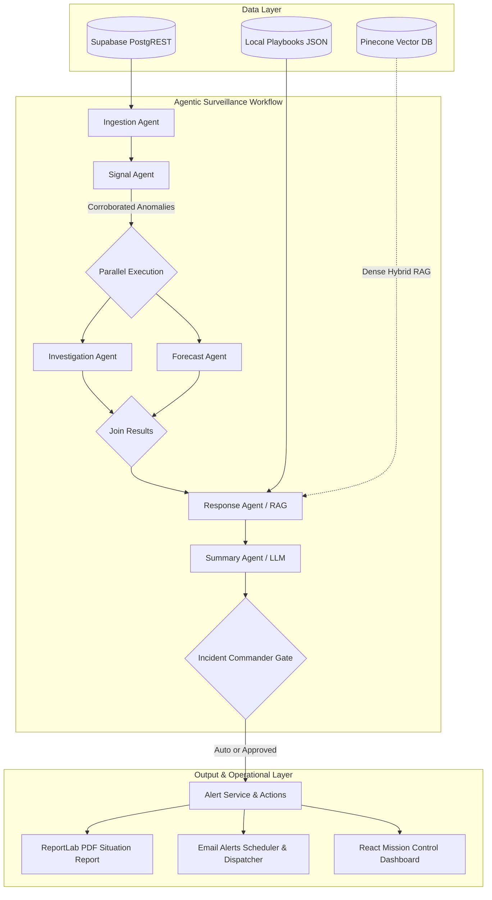

# Healthcare Crisis Response Agent: Complete Codebase Documentation

This document provides a comprehensive, sequential explanation of all codebase files, their functional implementations, the mathematical formulas and algorithmic techniques utilized, and how the **Agentic Framework (`agent_framework`)** powers the autonomous crisis surveillance pipeline.

---

## 1. System Architecture & Data Flow

The **Healthcare Crisis Response Agent (CrisisWatch)** is an intelligent epidemiological surveillance and incident orchestration platform. It detects public health anomalies, investigates multi-source signals, models projected outbreaks, queries protocol playbooks via Dense RAG, synthesizes AI intelligence briefings, and coordinates emergency response actions with human-in-the-loop oversight.

### End-to-End Pipeline



---

## 2. Sequential Code File Breakdown (Backend)

The backend is written in Python (FastAPI, Pydantic, ReportLab, Pinecone, Groq/HuggingFace) and structured as a modular pipeline. Below is each backend file explained in execution and architectural dependency order.

### 2.1 `backend/app/config.py`
- **Purpose**: Centralized application configuration and environment management.
- **Implementation**:
  - Implements `Settings` inheriting from `pydantic_settings.BaseSettings`, reading directly from `.env` with case-insensitive variable binding.
  - Exposes configuration for:
    - Supabase credentials (`supabase_url`, `supabase_publishable_key`, `supabase_secret_key`).
    - AI providers (`ai_provider`: `"deterministic"`, `"groq"`, or `"huggingface"`).
    - API keys and model parameters (`groq_api_key`, `groq_model`, `hf_api_key`, `hf_model`).
    - Pinecone Vector DB settings (`pinecone_api_key`, `pinecone_index_name`, `pinecone_cloud`, `pinecone_hospital`, `pinecone_namespace`, `pinecone_embedding_model`).
    - SMTP server parameters (`smtp_host`, `smtp_port`, `smtp_user`, `smtp_password`, `smtp_from_email`, `smtp_use_tls`).
    - CORS origins parser: The `@property origins` parses comma-separated `allowed_origins` into clean lists.
  - Cached via `@lru_cache()` in `get_settings()` to ensure a single immutable config instance across worker threads.

### 2.2 `backend/app/models.py`
- **Purpose**: Strict Pydantic schemas validating input payloads across API endpoints.
- **Implementation**:
  - `AlertGenerationRequest`: Validates `analysis_date` (defaulting to current UTC date) for running batch alert generation.
  - `AlertDecisionRequest`: Validates triage decisions (`decision` in `"escalate"`, `"investigate"`, `"monitor"`, `"dismiss"`, with reviewer notes and user identifier).
  - `ActionUpdateRequest`: Validates response task state updates (`status` in `"pending"`, `"in_progress"`, `"completed"`, `"blocked"`, with assignee and completion timestamps).
  - `EmailAlertConfigRequest`: Validates automated email schedule configuration (recipient lists, CC lists, schedule time `HH:MM`, timezone, threshold level, and active status).
  - `EmailAlertSendRequest`: Parameters for triggering ad-hoc manual email dispatches.

### 2.3 `backend/app/supabase_client.py`
- **Purpose**: Data Access Layer (DAL) wrapping the Supabase PostgREST HTTP API via `httpx.Client`.
- **Implementation**:
  - Dual-key authorization architecture:
    - `_read_headers`: Uses `supabase_publishable_key` for read-only queries.
    - `_write_headers`: Uses `supabase_secret_key` for mutations, upserts, and security-critical state changes.
  - Methods:
    - `get_hospitals()` & `get_conditions()`: Fetches hospital and disease reference tables.
    - `get_observations(hospital_code, condition_code, start_date, end_date)`: Retrieves structured surveillance observations (case counts, signal sources, test positivity).
    - `get_hospital_context(start_date, end_date, hospital_code)`: Fetches hospital staffing, bed occupancy, and supply snapshots.
    - `get_alerts()` / `create_alert()` / `decide_alert()`: Manages the incident alert lifecycle.
    - `get_actions()` / `create_actions()` / `update_action()`: Manages operational tasks assigned from crisis playbooks.
    - `get_email_alert_config()` / `save_email_alert_config()` / `log_email_alert_delivery()`: Manages email dispatch schedules and delivery audit logs.

### 2.4 `backend/app/signal_engine.py`
- **Purpose**: Core epidemiological statistical engine for detecting anomalies across multi-source syndromic streams.
- **Implementation**:
  - `SourceSignal`: Frozen dataclass capturing signal metrics (`hospital_code`, `condition_code`, `signal_source`, `current_count`, `baseline_mean`, `baseline_stdev`, `percent_change`, `z_score`, `level`).
  - `detect_source_signals()`:
    - Partitions observations by `(hospital_code, condition_code, signal_source)`.
    - Isolates observations falling within a rolling 28-day baseline window preceding `analysis_date`.
    - Requires $\ge 14$ baseline data points to prevent false alarms on sparse data.
    - Computes Gaussian baseline statistics ($Z$-score and percentage change).
    - Classifies alert levels (`escalate`, `investigate`, `monitor`, `normal`).
  - `summarise_clusters()`:
    - Groups isolated source signals by `(hospital_code, condition_code)`.
    - Evaluates **cross-source corroboration**: requires $\ge 2$ independent surveillance sources (e.g., Emergency Department + Lab Reports) to corroborate a cluster.
    - Returns ranked clusters prioritized by highest alert level and magnitude of change.

### 2.5 `backend/app/investigation_engine.py`
- **Purpose**: 14-day investigation of unusual hospital-level activity, isolating temporal outliers and describing available capacity.
- **Implementation**:
  - `_outlier_dates()`: Identifies extreme epidemiological spike dates using the **Modified Z-Score via Median Absolute Deviation (MAD)**.
  - `_source_summary()`: Computes directional trajectory (e.g. accelerating, slowing, steady) by comparing initial window medians to recent window medians.
  - `investigate_cluster()`:
    - Gathers 14-day historical case counts across all reporting sources.
    - Determines the peak case volume date and multi-day trend.
    - Aggregates hospital operations indicators (bed occupancy, staffing coverage, supply readiness).
    - Produces a consolidated investigation dossier passed to the AI summarizer.

### 2.6 `backend/app/forecast_engine.py`
- **Purpose**: Bounded epidemiological trajectory forecasting over a 7-day forward horizon.
- **Implementation**:
  - `forecast_cluster()`:
    - Uses a 14-day observation window to derive recent trajectory.
    - Calculates the observed relative growth rate between the most recent 7-day period and the preceding 7-day period.
    - Clamps daily growth rates within empirically safe boundaries to prevent runaway exponential explosion.
    - Generates 3 parallel forecast paths: **Best Case**, **Expected**, and **Worst Case**.
    - Outputs daily trajectory data points for visualization in line charts.

### 2.7 `backend/app/playbook_engine.py`
- **Purpose**: Standard Operating Procedure (SOP) response plan resolution from verified operational playbooks.
- **Implementation**:
  - `load_playbooks()`: LRU-cached loader reading `playbooks/response_playbooks.json`.
  - `select_response_plan(condition_code, level)`: Matches condition and severity level against predefined tactical response actions, extracting:
    - Priority-ranked operational tasks.
    - Target execution timeframes (e.g., "within 4 hours", "within 24 hours").
    - Responsible incident roles (e.g., Incident Commander, Epidemiologist, Logistics Lead, Public Information Officer).
    - Standard clinical and containment guidance.

### 2.8 `backend/app/playbook_documents.py`
- **Purpose**: Multi-format playbook parser and schema validator for dynamic playbook ingestion.
- **Implementation**:
  - `parse_playbook_document(filename, data)`:
    - Supports JSON, YAML, plain text, and binary formats (PDF via `pypdf`/`pdfplumber`, Word DOCX via `python-docx`).
    - Locates delimited JSON/YAML payloads (`PLAYBOOK_DATA_START ... PLAYBOOK_DATA_END`) inside formatted documents.
    - Validates schema compliance (`metadata`, `version`, `conditions`, action item structure).
    - Computes a SHA-256 integrity hash of document content.

### 2.9 `backend/app/pinecone_rag.py`
- **Purpose**: Dense semantic retrieval layer over Pinecone Vector DB for augmentative playbook search.
- **Implementation**:
  - `build_playbook_documents()`: Deconstructs structured playbook playbooks into atomic semantic passages enriched with metadata tags (`condition_code`, `alert_level`, `version`).
  - `_retrieve_sync()`:
    - Encodes natural language queries into 1024-dimensional embeddings using `llama-text-embed-v2`.
    - Queries Pinecone serverless indexes with cosine similarity and metadata filters.
  - `select_response_plan_with_rag()`:
    - Fetches the authoritative deterministic playbook as the primary ground truth.
    - Appends semantically retrieved external SOP passages and contextual guidance into the response payload.

### 2.10 `backend/app/index_playbooks.py`
- **Purpose**: Standalone CLI script to vectorize and index approved playbooks into Pinecone.
- **Implementation**:
  - Inspects existing Pinecone indexes, creating the index with `ServerlessSpec` and `metric="cosine"` if missing.
  - Supports `--recreate` to purge and rebuild indexes.
  - Generates passage embeddings via Pinecone Inference API and upserts vector records with payload metadata.

### 2.11 `backend/app/briefing_engine.py`
- **Purpose**: LLM intelligence synthesis layer producing executive briefings with prompt injection defenses.
- **Implementation**:
  - Multi-provider adapter pattern:
    - `deterministic`: Rule-based fallback generating instant human-readable briefings without external API calls.
    - `groq`: Ultra-fast inference via Groq Cloud (`llama-3.3-70b-versatile`) with strict JSON schema enforcement (`response_format={"type": "json_object"}`).
    - `huggingface`: Serverless inference via Hugging Face Inference Router.
  - Prompt Injection Defense:
    - Encapsulates untrusted epidemiological data within strict boundary tags: `<untrusted_evidence_json> ... </untrusted_evidence_json>`.
    - Enforces system instructions prohibiting model compliance with instructions inside data tags.
  - Output Sanitization:
    - Validates response schemas against `BRIEFING_SCHEMA` and `FORECAST_BRIEFING_SCHEMA`.
    - Rejects outputs containing HTML `<script>` tags, `javascript:` schemes, or external hyperlinks.
    - Automatically falls back to deterministic briefing on LLM timeout or parse error.

### 2.12 `backend/app/action_engine.py`
- **Purpose**: Operational task generation and SLA deadline computation.
- **Implementation**:
  - `_due_at(timeframe, reference_time)`: Regex and natural language parser converting timeframe strings (e.g. `"within 4 hours"`, `"within 2 days"`) into ISO-8601 UTC timestamps ($T_{\text{due}} = T_{\text{ref}} + \Delta t$).
  - `action_rows()`: Converts abstract playbook response tasks into actionable database records linked to specific incident alert IDs.

### 2.13 `backend/app/alert_service.py`
- **Purpose**: Automated incident triaging and database alert generation.
- **Implementation**:
  - `generate_eligible_alerts()`:
    - Invokes `signal_engine` over current observations.
    - Filters clusters meeting minimum alert criteria (corroborated by multiple sources and level $\in \{\text{"investigate"}, \text{"escalate"}\}$).
    - Idempotently creates alerts in Supabase (handles HTTP 409 conflict gracefully if an alert already exists for the hospital/condition/date).

### 2.14 `backend/app/reporting.py`
- **Purpose**: Automated situation report generation in publication-grade PDF format via ReportLab.
- **Implementation**:
  - `build_timeline(alert, actions)`: Aggregates creation, triage, and task status events into an audit timeline.
  - `build_situation_report(alert, actions)`:
    - Generates a formatted A4 PDF containing:
      - Header banner with incident severity color-coding.
      - Incident Metadata Table (Hospital, Condition, Trigger Date, Reviewer).
      - Epidemiological Signal Corroboration Table.
      - Decision Audit Trail.
      - Tactical Action Assignment Table with role owners and SLAs.
      - Watermark and pagination footer.

### 2.15 `backend/app/email_alerts.py`
- **Purpose**: Automated email notification system with scheduled polling and role-specific dispatch.
- **Implementation**:
  - Consolidated HTML and plain-text email generation with incident severity badging.
  - Role-specific notifications:
    - Incident Commander review requests.
    - Task owner notifications for assigned operational actions.
  - `EmailAlertScheduler`:
    - Async background worker polling every 30 seconds inside FastAPI lifespan.
    - Evaluates configured delivery time `HH:MM` within specified timezones (e.g., `Asia/Kolkata`, `UTC`).
    - Uses `schedule_date` idempotency guards to ensure emails are sent exactly once per calendar day.

### 2.16 `backend/app/orchestrator.py`
- **Purpose**: Autonomous surveillance workflow using the **Agentic Framework (`agent_framework`)**.
- *(Explained in extensive detail in Section 5).*

### 2.17 `backend/app/main.py`
- **Purpose**: FastAPI application entry point, lifecycle management, and REST API routing.
- **Implementation**:
  - Implements async `lifespan` context manager initializing and shutting down `EmailAlertScheduler`.
  - Configures CORS middleware dynamically from `settings.origins`.
  - Exposes 20+ REST endpoints covering:
    - System health: `GET /health`
    - Reference data: `GET /hospitals`, `GET /conditions`, `GET /data-availability`
    - Surveillance & Analytics: `GET /observations`, `GET /signals`, `GET /forecast`, `GET /investigation`
    - Intelligence: `POST /briefing`, `POST /forecast/briefing`, `POST /briefing/aggregate`
    - Agentic Workflow: `POST /workflow`
    - Incident Management: `GET /alerts`, `POST /alerts/generate`, `POST /alerts/{id}/decision`, `GET /actions`, `PATCH /actions/{id}`
    - Reporting: `GET /incidents/{id}/timeline`, `GET /incidents/{id}/report.pdf`
    - Email Management: `GET /email-alerts/dashboard`, `POST /email-alerts/config`, `POST /email-alerts/send`

---

## 3. Sequential Code File Breakdown (Frontend)

The frontend is a single-page React 18 application built with TypeScript, Vite, and Lucide icons, styled using responsive Vanilla CSS.

### 3.1 `frontend/src/types.ts`
- **Purpose**: TypeScript interfaces defining all data models matching backend schemas.
- **Implementation**:
  - Defines `Hospital`, `Condition`, `Observation`, `Cluster`, `SignalResponse`, `AlertRecord`, `ForecastResponse`, `InvestigationResponse`, `ResponsePlan`, `EvidenceBriefing`, `WorkflowRun`, `IncidentAction`, `IncidentTimeline`, `EmailAlertConfig`, and `EmailAlertDashboard`.

### 3.2 `frontend/src/api.ts`
- **Purpose**: Type-safe HTTP communication layer wrapping `fetch`.
- **Implementation**:
  - `getJson<T>()` and `sendJson<T>()`: Generic fetch handlers with error extraction.
  - Consolidates all backend interactions into an exported `api` service object.

### 3.3 `frontend/src/App.tsx`
- **Purpose**: Mission Control Dashboard and primary application view container.
- **Implementation**:
  - Manages tab navigation (`dashboard`, `alerts`, `actions`, `emails`, `playbooks`) synchronized with browser history (`history.pushState`).
  - Interactive multi-parameter filtering (Hospital dropdown, Condition dropdown, Date picker).
  - Visualization:
    - Aggregated multi-source surveillance observation trends.
    - Recharts line charts displaying historical observations alongside 7-day projected forecast scenarios (Best, Expected, Worst).
    - Anomaly cluster badges with cross-source corroboration indicators.
  - Action management: In-line triage controls (Escalate, Investigate, Monitor, Dismiss) and task status update toggles.
  - Agentic workflow trigger button showing real-time step execution timeline and audit trace.

### 3.4 `frontend/src/EmailAlertsPage.tsx`
- **Purpose**: Dedicated administrative interface for email dispatch scheduling and audit history.
- **Implementation**:
  - Form controls for configuring notification thresholds, schedule times (`HH:MM`), timezones, recipient emails, and role-specific contact mappings.
  - Audit log table displaying recent email dispatches, status codes, recipient counts, and error logs.
  - Manual "Send Test / Dispatch Now" trigger.

### 3.5 `frontend/src/NotificationBanner.tsx`
- **Purpose**: Reusable floating feedback toast for asynchronous actions.
- **Implementation**:
  - Supports `success`, `error`, and `info` status variants.
  - Automatically dismisses after 6 seconds with smooth CSS exit transitions.

### 3.6 `frontend/src/styles.css`
- **Purpose**: Complete design system, theming, layout, and component styling.
- **Implementation**:
  - Dark-mode optimized color palette with high-contrast accessibility tokens.
  - Glassmorphic panels, CSS grid layouts, responsive breakpoints, status badges, and loading skeleton animations.

### 3.7 `frontend/src/main.tsx`
- **Purpose**: React DOM root mounting and application initialization.

---

## 4. Mathematical Formulas and Algorithmic Techniques

CrisisWatch employs robust mathematical and statistical techniques across each phase of the surveillance pipeline.

### 4.1 Statistical Anomaly Detection (Signal Engine)

For a specific hospital $R$, condition $C$, and surveillance source $S$ on target date $t$:

#### 1. Baseline Window
A rolling 28-day window prior to the analysis date is selected:
$$W_{\text{baseline}} = \{t - 28, t - 27, \dots, t - 1\}$$
*Constraint*: $|W_{\text{baseline}}| \ge 14$ non-null observation points required.

#### 2. Baseline Mean and Standard Deviation
$$\mu_{\text{baseline}} = \frac{1}{N} \sum_{i=1}^{N} x_i$$
$$\sigma_{\text{baseline}} = \sqrt{\frac{1}{N - 1} \sum_{i=1}^{N} (x_i - \mu_{\text{baseline}})^2}$$

#### 3. Percentage Change ($\Delta\%$)
$$\Delta\% = \begin{cases} 
\left( \frac{x_{\text{current}} - \mu_{\text{baseline}}}{\mu_{\text{baseline}}} \right) \times 100 & \text{if } \mu_{\text{baseline}} > 0 \\
0 & \text{if } \mu_{\text{baseline}} = 0 
\end{cases}$$

#### 4. Anomaly Standard Score ($Z_{\text{score}}$)
$$Z = \begin{cases} 
\frac{x_{\text{current}} - \mu_{\text{baseline}}}{\sigma_{\text{baseline}}} & \text{if } \sigma_{\text{baseline}} > 0 \\
0 & \text{if } \sigma_{\text{baseline}} = 0 
\end{cases}$$

#### 5. Alert Level Classification Matrix
$$\text{Level}(Z, \Delta\%) = \begin{cases} 
\mathbf{escalate} & \text{if } \Delta\% \ge 100\% \text{ and } Z \ge 2.5 \\
\mathbf{investigate} & \text{if } \Delta\% \ge 50\% \text{ and } Z \ge 1.5 \\
\mathbf{monitor} & \text{if } \Delta\% \ge 25\% \\
\mathbf{normal} & \text{otherwise}
\end{cases}$$

#### 6. Corroboration Filter
An anomaly cluster is corroborated if and only if:
$$N_{\text{active\_sources}} \ge 2 \quad \text{where } \text{Level}(\text{source}) \in \{\mathbf{monitor}, \mathbf{investigate}, \mathbf{escalate}\}$$

---

### 4.2 Outlier Detection via Modified Z-Score with MAD (Investigation Engine)

To detect sudden, localized spike dates within a 14-day investigation window without distortion from extreme outliers, the system uses the **Modified Z-Score based on Median Absolute Deviation (MAD)** (Boris Iglewicz & David Hoaglin, 1993):

#### 1. Sample Median ($\tilde{x}$)
$$\tilde{x} = \text{median}(X)$$

#### 2. Median Absolute Deviation (MAD)
$$\text{MAD} = \text{median}\left( \{ |x_i - \tilde{x}| : x_i \in X \} \right)$$

#### 3. Modified Z-Score ($M_i$)
$$M_i = \begin{cases} 
\frac{0.6745 \cdot (x_i - \tilde{x})}{\text{MAD}} & \text{if } \text{MAD} > 0 \\
0 & \text{if } \text{MAD} = 0 
\end{cases}$$

*(The factor $0.6745$ represents the 75th percentile of the standard normal distribution, making MAD an asymptotically unbiased estimator of $\sigma$ for normal data).*

#### 4. Outlier Threshold Criterion
A date $t_i$ is flagged as an epidemiological outlier spike date if:
$$M_i > 3.5$$

---

### 4.3 Bounded Compound Growth Scenario Forecasting (Forecast Engine)

The system models short-term 7-day outbreak trajectory using compound exponential growth bounded by realistic public health transmission limits:

#### 1. 7-Day vs Prior 7-Day Window Comparison
Let $W_{\text{recent}}$ be the case counts for days $[t-6, t]$ (7 days) and $W_{\text{prior}}$ be days $[t-13, t-7]$ (7 days):
$$\mu_{\text{recent}} = \frac{1}{7} \sum_{i \in W_{\text{recent}}} x_i, \quad \mu_{\text{prior}} = \frac{1}{7} \sum_{j \in W_{\text{prior}}} x_j$$

#### 2. Observed Relative Growth Rate
$$g_{\text{observed}} = \begin{cases} 
\frac{\mu_{\text{recent}} - \mu_{\text{prior}}}{\mu_{\text{prior}}} & \text{if } \mu_{\text{prior}} > 0 \\
0 & \text{if } \mu_{\text{prior}} = 0 
\end{cases}$$

#### 3. Clamped Daily Growth Rate ($r_{\text{expected}}$)
To prevent numerical runaway, the estimated daily compounding rate is clamped:
$$r_{\text{daily}} = \frac{g_{\text{observed}}}{7}$$
$$r_{\text{expected}} = \max\left(-0.08, \; \min\left(0.12, \; r_{\text{daily}}\right)\right)$$

#### 4. Multi-Scenario Modeling
- **Best Case Scenario Rate**:
  $$r_{\text{best}} = r_{\text{expected}} - 0.05$$
- **Worst Case Scenario Rate**:
  $$r_{\text{worst}} = \min\left(0.25, \; r_{\text{expected}} + 0.08\right)$$

#### 5. Forward Projection Equation
For each forward day $k \in \{1, 2, \dots, 7\}$ starting from current volume $Y_0 = x_{\text{current}}$:
$$\hat{Y}_{k} = \max\left(0, \; \text{round}\left(Y_0 \cdot (1 + r)^k\right)\right)$$

---

### 4.4 Prompt Injection Defense and Grounded AI Synthesis

In `briefing_engine.py`, AI outputs are strictly constrained against data manipulation and prompt injection:

1. **Untrusted Data Boundary**:
   Surveillance outputs and user-provided notes are serialized to JSON and wrapped in explicit boundary markers:
   ```xml
   <untrusted_evidence_json>
   {"hospital": "REG-01", "counts": [...]}
   </untrusted_evidence_json>
   ```
2. **Schema Invariant Enforcement**:
   The LLM must strictly output a JSON object adhering to `BRIEFING_SCHEMA`:
   ```json
   {
     "headline": "string",
     "situation": "string",
     "evidence": ["string"],
     "uncertainties": ["string"],
     "recommended_review": "string"
   }
   ```
3. **Safety Heuristics**:
   All outputs undergo string inspection: any content containing `<script`, `javascript:`, or external URLs is discarded and routed to the deterministic engine.

---

## 5. Agentic Framework Integration (`agent_framework`)

CrisisWatch uses the **`agent_framework`** package (`agent-framework-core==1.21.0`) to orchestrate its autonomous crisis surveillance pipeline.

### 5.1 Core Agentic Concepts

1. **Step-Based Decomposition (`@step`)**:
   Individual specialized subagents are implemented as modular step functions decorated with `@step`. Each agent has a focused domain of responsibility, well-defined input contracts, and isolated failure domains.
2. **Deterministic Replay Keys (`replay_key`)**:
   Expensive or state-modifying steps specify a `replay_key` (e.g., `replay_key="investigation"`, `replay_key="forecast"`), allowing the engine to cache and deterministically replay subagent executions during workflow retries or audits.
3. **Directed Workflow Graph (`@workflow`)**:
   The overall surveillance workflow is declared with the `@workflow` decorator, defining execution dependencies, concurrent execution branches, and synchronization gates.
4. **Human-In-The-Loop (HITL) Gating**:
   A dedicated gate agent (`incident_commander_gate`) acts as an operational barrier, checking if an alert level demands human commander triage before autonomous activation.

---

### 5.2 Step Agents Implementation

All agent steps are defined in `backend/app/orchestrator.py`:

#### 1. `ingestion_agent`
- **Role**: Ingests hospital surveillance observations and operations snapshots for the specified date range.
- **Behavior**: Calls `supabase.get_observations()` and `supabase.get_hospital_context()`. Validates data volume. Emits structured telemetry trace.

#### 2. `signal_agent`
- **Role**: Executes epidemiological statistical anomaly detection.
- **Behavior**: Invokes `signal_engine.detect_source_signals()` and `summarise_clusters()`. Selects the most critical active cluster for in-depth investigation.

#### 3. `investigation_agent` (`replay_key="investigation"`)
- **Role**: Conducts a 14-day temporal investigation on the active cluster.
- **Behavior**: Computes Modified Z-score outliers, identifies peak volume dates, and summarizes hospital operations indicators.

#### 4. `forecast_agent` (`replay_key="forecast"`)
- **Role**: Projects 7-day epidemiological trajectories.
- **Behavior**: Runs the compound growth model, outputting Best Case, Expected, and Worst Case scenarios.

#### 5. `response_agent`
- **Role**: Resolves operational response protocols.
- **Behavior**: Queries local JSON response playbooks or executes dense semantic search via Pinecone RAG to generate prioritized action items.

#### 6. `summary_agent`
- **Role**: Synthesizes human-readable intelligence briefings.
- **Behavior**: Dispatches grounded evidence to the configured AI provider (`Groq`, `HuggingFace`, or deterministic fallback) to generate an executive situation summary.

#### 7. `incident_commander_gate`
- **Role**: Human-in-the-loop decision gate.
- **Behavior**: Evaluates cluster severity. If `level == "escalate"`, it pauses automatic closure and flags status as `waiting_for_approval` until an Incident Commander signs off.

---

### 5.3 Parallel Step Execution and Workflow Graph

The workflow utilizes `asyncio.gather` inside the workflow definition to run the **Investigation Agent** and **Forecast Agent** concurrently once the **Signal Agent** isolates an active cluster:

```mermaid
sequenceDiagram
    autonumber
    actor Trigger as Client / Scheduler
    participant WF as Workflow Orchestrator
    participant IA as Ingestion Agent
    participant SA as Signal Agent
    participant INV as Investigation Agent
    participant FC as Forecast Agent
    participant RA as Response Agent
    participant SUM as Summary Agent
    participant ICG as Commander Gate

    Trigger->>WF: run(CrisisWorkflowRequest)
    WF->>IA: Ingest observations & context
    IA-->>WF: Raw observation records
    WF->>SA: Evaluate baseline Z-scores
    SA-->>WF: Corroborated anomaly cluster

    rect rgb(20, 30, 45)
        note over WF,FC: Concurrent Step Execution (asyncio.gather)
        par Parallel Deep Dive
            WF->>INV: Investigate outliers & context (replay_key="investigation")
        and Parallel Projection
            WF->>FC: Model 7-day forecast scenarios (replay_key="forecast")
        end
        INV-->>WF: Outlier dates & trend summary
        FC-->>WF: Best/Expected/Worst projections
    end

    WF->>RA: Select response plan & query RAG
    RA-->>WF: Action tasks & guidance
    WF->>SUM: Generate grounded briefing
    SUM-->>WF: Structured AI briefing
    WF->>ICG: Evaluate triage gate threshold
    ICG-->>WF: Workflow status (completed / waiting_for_approval)
    WF-->>Trigger: Consolidated WorkflowRun output
```



---

### 5.4 State Transitions & Telemetry Tracing

Every workflow execution produces a `WorkflowRun` object with fine-grained execution metadata:

- **State Transitions**:
  - `completed`: Successfully analyzed, triaged, and plan resolved.
  - `waiting_for_approval`: Escalation threshold reached; held pending human Incident Commander review.
  - `partial`: Executed with fallback heuristics (e.g. LLM degradation or missing hospital operations data).
  - `failed`: Terminal unrecoverable error during execution.
- **Telemetry Trace Record (`_trace`)**:
  Captures per-step execution metrics:
  ```json
  {
    "step": "investigation_agent",
    "component": "investigation_engine",
    "status": "completed",
    "duration_ms": 42.18,
    "output": { "outlier_dates": ["2026-10-10"], "peak_count": 84 }
  }
  ```

---

## 6. Summary Reference Table

| File | Primary Responsibility | Key Functions / Classes | Inputs $\rightarrow$ Outputs |
| :--- | :--- | :--- | :--- |
| `config.py` | Environment Settings | `Settings`, `get_settings()` | `.env` $\rightarrow$ Configuration Singleton |
| `models.py` | Pydantic Request Schemas | `AlertGenerationRequest`, `AlertDecisionRequest` | JSON $\rightarrow$ Validated DTOs |
| `supabase_client.py`| Data Access Layer | `SupabaseRepository` | REST API $\rightarrow$ Database Records |
| `signal_engine.py` | Baseline Anomaly Detection | `detect_source_signals()`, `summarise_clusters()` | 28d Obs $\rightarrow$ Corroborated Clusters |
| `investigation_engine.py`| Outlier & Context Analysis| `investigate_cluster()`, `_outlier_dates()` | 14d Obs $\rightarrow$ Outliers (MAD) & Trend |
| `forecast_engine.py`| Outbreak Projections | `forecast_cluster()` | 14d Obs $\rightarrow$ 3 Bounded 7-Day Scenarios |
| `playbook_engine.py`| SOP Action Resolution | `select_response_plan()`, `load_playbooks()` | Condition & Level $\rightarrow$ Task Protocol |
| `playbook_documents.py`| Playbook Document Parser | `parse_playbook_document()` | PDF/DOCX/YAML $\rightarrow$ Validated Playbook |
| `pinecone_rag.py` | Semantic Playbook Search | `select_response_plan_with_rag()` | Natural Query $\rightarrow$ Dense RAG Passages |
| `index_playbooks.py`| Vector Indexing CLI | `main()` | Playbook JSON $\rightarrow$ Pinecone Embeddings |
| `briefing_engine.py`| AI Intelligence Summaries | `generate_evidence_briefing()`, `_grounded_evidence_message()` | Cluster Evidence $\rightarrow$ Grounded JSON Briefing |
| `action_engine.py` | SLA & Task Generation | `action_rows()`, `_due_at()` | Response Plan $\rightarrow$ DB Action Rows |
| `alert_service.py` | Alert Triaging Service | `generate_eligible_alerts()` | Analysis Date $\rightarrow$ Created DB Alerts |
| `reporting.py` | PDF Situation Report | `build_situation_report()`, `build_timeline()` | Alert & Actions $\rightarrow$ Formatted A4 PDF |
| `email_alerts.py` | Email Dispatch & Polling | `EmailAlertScheduler`, `run_email_alert()` | Config & Alerts $\rightarrow$ Scheduled SMTP Emails |
| `orchestrator.py` | Multi-Agent Orchestration | `@step`, `@workflow`, `run_workflow()` | Workflow Request $\rightarrow$ Full Trace & Decision |
| `main.py` | FastAPI REST Surface | `app`, lifespan, 20+ endpoint handlers | HTTP Requests $\rightarrow$ Responses |
| `types.ts` | Frontend Type System | `Observation`, `Cluster`, `WorkflowRun`, etc. | Interface Definitions |
| `api.ts` | Type-Safe Client API | `getJson()`, `sendJson()`, `api` | Fetch $\rightarrow$ Typed UI State |
| `App.tsx` | Dashboard & Mission Control| `App` component | UI State $\rightarrow$ Rendered Analytics & Actions |
| `EmailAlertsPage.tsx`| Email Configuration UI | `EmailAlertsPage` component | Settings Form $\rightarrow$ Saved Email Config |
