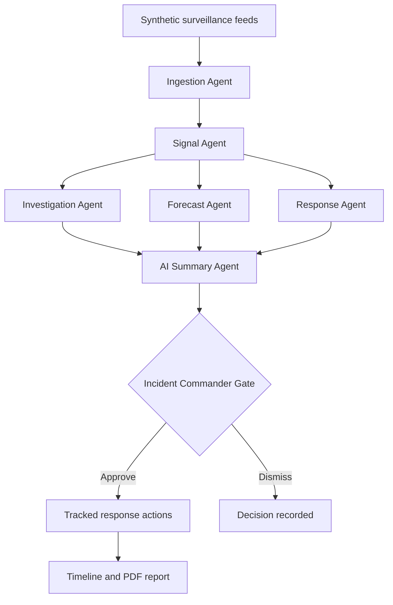

# Healthcare Crisis Prediction and Response Agent

A public-health decision-support application that monitors synthetic surveillance feeds, detects unusual disease activity, investigates corroborating evidence, forecasts short-term planning scenarios, and prepares bounded response actions for human approval.

The project uses synthetic, aggregated data only. It is not a diagnostic system and does not declare real outbreaks.

## Project scope

The current implementation covers three conditions selected for shared data structure and manageable surveillance complexity:

| Condition | Primary signals | Context |
|---|---|---|
| Influenza-like illness (ILI) | Visits, laboratory positives, pharmacy demand | Hospital capacity and staffing |
| Acute gastroenteritis (AGE) | Visits, laboratory positives, pharmacy demand | Hospital capacity and supplies |
| Dengue | Suspected visits, laboratory positives | Hospital capacity and staffing |

The system monitors four simulated hospitals from 1 October 2025 through 13 October 2026. Counts represent observations at each hospital; they do not imply a geographic outbreak.

## Workflow



Every execution returns a trace with component status and timing. Controlled response actions are never issued automatically.

## Main capabilities

- Multi-source surveillance for visits, laboratory positives, pharmacy demand, and hospital context.
- Transparent baseline anomaly detection by hospital, condition, source, and date.
- Hospital-level signal investigation with source comparison, peak activity, data quality, bed occupancy, staffing coverage, and supply readiness.
- Seven-day best-case, expected, and worst-case planning scenarios.
- Prominent forecast outlook with day-seven metrics and an optional structured LLM interpretation.
- Versioned response playbooks with owners, timeframes, approval requirements, and condition guidance.
- Optional Pinecone RAG retrieval over approved playbook guidance; deterministic playbook actions remain authoritative.
- PDF, DOCX, YAML, and JSON playbook validation.
- Deterministic evidence briefings with optional Groq or Hugging Face generation.
- Incident Commander approval and dismissal workflow.
- Assigned action tracking with due dates and completion state.
- Chronological incident timeline and downloadable PDF situation report.
- Scheduled and manual threshold email alerts with configurable recipients, severity, timezone, and delivery history.
- Configurable Incident Commander review emails sent when a corroborated signal enters the review queue.
- Role-based task assignment emails sent after Incident Commander approval, with configurable Epidemiology, Operations, and Incident Communications addresses.

## Technology stack

| Layer | Technology |
|---|---|
| Dashboard | React, TypeScript, Vite, Recharts, Lucide |
| API and orchestration | FastAPI, Microsoft Agent Framework, Pydantic, HTTPX |
| Database | Supabase Postgres |
| AI summaries | Deterministic fallback, optional Groq or Hugging Face |
| Playbooks | JSON, YAML, PDF, DOCX; optional Pinecone RAG |
| Reports | ReportLab PDF generation |
| Local workflow | Python virtual environment, npm, Make, Bash scripts, PowerShell scripts |

Docker is not required. The project runs directly with a Python virtual environment and the Vite development server.

## Repository structure

```text
backend/app/       FastAPI routes and workflow components
frontend/src/      React command dashboard
data/              Deterministic synthetic-data generator
playbooks/         Active response playbook and format guidance
supabase/          Schema, policies, seed data, and migrations
scripts/           Local setup and development commands
DATASET_GUIDE.md   Dataset coverage and design notes
WORKFLOWS_AND_FEATURES.md        Implemented workflows, features and boundaries
AGENT_PROGRESS_AND_FEATURES.md  Agent implementation and configuration status
```

## Microsoft Agent Framework orchestration

The end-to-end surveillance pipeline runs as a Microsoft Agent Framework functional workflow. Ingestion, signal detection, investigation, forecasting, response-plan retrieval, briefing generation, and the Incident Commander gate are named framework steps. Investigation and forecasting retain their parallel execution, and the existing `/api/v1/workflow` response contract is unchanged.

The framework is used for orchestration and observability; it does not replace the deterministic domain engines. Alert levels still come from transparent rules, approved actions still come from the versioned playbook, Pinecone remains supporting retrieval only, and controlled actions still require the existing human approval endpoint. No Azure resource is required for local execution. Deploying the workflow as a hosted Microsoft Foundry agent additionally requires Azure Developer CLI and a configured Foundry project.

The project pins `agent-framework-core==1.21.0`. Microsoft currently marks the functional workflow API as experimental, so framework upgrades should be tested before changing this version.

For concise implementation documentation, see [Workflows and Features](WORKFLOWS_AND_FEATURES.md) and [Agent Progress and Implemented Features](AGENT_PROGRESS_AND_FEATURES.md).

## Quick start

Requirements:

- Python 3.11 or newer
- Node.js 20 or newer
- npm
- Make and Bash on Linux/macOS, or PowerShell on Windows

Install all dependencies on Linux/macOS:

```bash
make setup
```

Install all dependencies on Windows PowerShell:

```powershell
.\scripts\setup.ps1
```

Configure `backend/.env` using `backend/.env.example`. The final credential checklist is below.

Start the API and dashboard together on Linux/macOS:

```bash
make dev
```

Start the API and dashboard together on Windows PowerShell:

```powershell
.\scripts\dev.ps1
```

Open:

- Command dashboard: `http://127.0.0.1:5173/command-dashboard`
- Alert review: `http://127.0.0.1:5173/alert-review`
- Action tracker: `http://127.0.0.1:5173/action-tracker`
- Email alerts: `http://127.0.0.1:5173/email-alerts`
- Playbook library: `http://127.0.0.1:5173/playbook-library`
- API documentation: `http://127.0.0.1:8000/docs`
- Health check: `http://127.0.0.1:8000/health`

Individual services can be started with `make api` and `make web` on Linux/macOS. On Windows, you can also run the backend from the repository root:

```powershell
.\.venv\Scripts\python.exe -m uvicorn app.main:app --reload --host 127.0.0.1 --port 8000 --app-dir backend
```

Then run the frontend in a second PowerShell window:

```powershell
npm run dev --prefix frontend
```

### Enable Pinecone playbook RAG

After installing backend requirements and configuring the `PINECONE_*` variables in `backend/.env`, index the approved playbook from the repository root:

```powershell
$env:PYTHONPATH = "backend"
python -m app.index_playbooks
```

Then set `PINECONE_RAG_ENABLED=true` and restart the API. The `/api/v1/response-plan`, workflow, briefing, and approval paths will retrieve relevant playbook context. Retrieved text is evidence only; executable actions still come from the versioned `playbooks/response_playbooks.json` and remain behind human approval.

## Useful commands

```bash
make setup   # Install pinned Python and frontend dependencies
make dev     # Run API and dashboard without Docker
make check   # Compile the backend and build the frontend
make data    # Regenerate deterministic synthetic CSV files
```

Windows PowerShell equivalents:

```powershell
.\scripts\setup.ps1
.\scripts\dev.ps1
.\scripts\check.ps1
.\.venv\Scripts\python.exe data\generate_synthetic_surveillance.py
```

## Demonstration scenarios

Use these dates in the dashboard to demonstrate known synthetic patterns:

| Date | Scope | Expected behavior |
|---|---|---|
| 10 November 2025 | Lakeside Hospital / AGE | Corroborated investigation signal |
| 15 December 2025 | Central Hospital / ILI | Corroborated investigation signal |
| 15 December 2025 | East Hospital / Dengue | Corroborated investigation signal |
| 30 September 2026 | Central Hospital / ILI | No active threshold signal |

## API overview

| Endpoint | Purpose |
|---|---|
| `GET /api/v1/hospitals` | Available hospitals |
| `GET /api/v1/conditions` | Monitored conditions |
| `GET /api/v1/observations` | Filtered aggregate surveillance observations |
| `GET /api/v1/signals` | Rule-based signal and cluster output |
| `GET /api/v1/investigation` | Correlated cluster evidence |
| `GET /api/v1/forecast` | Seven-day planning scenarios |
| `GET /api/v1/forecast/briefing` | Structured AI interpretation of prepared forecast scenarios |
| `GET /api/v1/response-plan` | Bounded playbook actions |
| `GET /api/v1/briefing` | Stakeholder evidence briefing |
| `GET /api/v1/workflow` | Complete workflow trace |
| `GET /api/v1/alerts` | Protected approval queue |
| `POST /api/v1/alerts/generate` | Create eligible alerts idempotently |
| `PATCH /api/v1/alerts/{id}/decision` | Approve or dismiss an alert |
| `GET /api/v1/actions` | Protected incident actions |
| `PATCH /api/v1/actions/{id}` | Assign or update an action |
| `GET /api/v1/incidents/{id}/timeline` | Incident audit timeline |
| `GET /api/v1/incidents/{id}/report.pdf` | Downloadable situation report |
| `POST /api/v1/playbooks/validate` | Validate an uploaded playbook |
| `GET /api/v1/email-alerts/dashboard` | Scheduler configuration, readiness, next run, and delivery history |
| `PUT /api/v1/email-alerts/config` | Save recipients and scheduled delivery settings |
| `POST /api/v1/email-alerts/send` | Manually evaluate thresholds and send an alert digest |

Interactive request and response schemas are available through FastAPI at `/docs`.

## Data and security boundaries

- No patient-level data, names, clinical records, or real health events are stored.
- Public browser access is read-only and limited to synthetic reference and surveillance tables.
- Alerts and incident actions have RLS enabled and no anonymous or authenticated policies.
- The Supabase secret key is used only by FastAPI and must never be placed in frontend files.
- AI providers receive prepared aggregate evidence only and cannot change alert levels or decisions.
- Groq and Hugging Face failures return a deterministic evidence summary.
- PDF and DOCX playbooks require an embedded structured section and are validated before use.
- Human approval is required before controlled response tasks are created.

## Supabase project

- Project name: `healthcare-crisis-response-agent`
- Hospital: `ap-south-1`
- Project reference: `jinbmggobfeccvqrnnze`

The database contains four simulated hospitals, three monitored conditions, 12,096 surveillance observations, and 1,512 hospital operations snapshots. Schema changes are tracked in `supabase/migrations/`.

## Final environment configuration

Backend variables:

| Variable | Required | Purpose |
|---|---|---|
| `SUPABASE_URL` | Yes | Supabase project API URL |
| `SUPABASE_PUBLISHABLE_KEY` | Yes | Read-only synthetic surveillance access |
| `SUPABASE_SECRET_KEY` | For protected workflows | Server-only alert, action, timeline, and report access |
| `ALLOWED_ORIGINS` | Yes | Dashboard origins allowed by CORS |
| `BACKEND_PORT` | No | Local API port used by launch scripts; default `8000`, with `8001` and `8002` supported as alternatives |
| `AI_PROVIDER` | No | `deterministic`, `groq`, or `huggingface` |
| `GROQ_API_KEY` and `GROQ_MODEL` | When using Groq | Groq structured summary generation |
| `HUGGINGFACE_TOKEN` and `HUGGINGFACE_MODEL` | When using Hugging Face | Hugging Face structured summary generation |
| `SMTP_HOST`, `SMTP_PORT` | For email alerts | SMTP server and port, commonly port 587 with TLS |
| `SMTP_USERNAME`, `SMTP_PASSWORD` | When SMTP requires authentication | Server-only mail credentials or app password |
| `SMTP_FROM_EMAIL`, `SMTP_FROM_NAME` | For email alerts | Sender address and display name |
| `SMTP_USE_TLS` | No | Enable STARTTLS; defaults to `true` |
| `PUBLIC_APP_URL` | No | Dashboard link included in notification emails |
| `EMAIL_SCHEDULER_POLL_SECONDS` | No | Scheduler check interval; defaults to 30 seconds |
| `PINECONE_RAG_ENABLED` | No | Enable playbook retrieval-augmented context; defaults to `false` |
| `PINECONE_API_KEY` | When using Pinecone | Server-only Pinecone API key |
| `PINECONE_INDEX_NAME` | When using Pinecone | Pinecone index containing approved playbook embeddings |
| `PINECONE_INDEX_HOST` | No | Optional index host; use when preferred over index-name lookup |
| `PINECONE_NAMESPACE` | No | Namespace for approved playbook vectors |
| `PINECONE_EMBEDDING_MODEL` | No | Pinecone hosted embedding model; defaults to `llama-text-embed-v2` |
| `PINECONE_TOP_K` | No | Maximum retrieved playbook matches; defaults to 5 |

Frontend variables:

| Variable | Default | Purpose |
|---|---|---|
| `VITE_API_URL` | `http://127.0.0.1:8000` | FastAPI base URL; ports 8001 and 8002 are supported alternatives |

Never use `VITE_` variables for Supabase secret or AI-provider credentials; Vite exposes them to the browser.

## Important limitation

This repository demonstrates surveillance, investigation, coordination, and human-gated response using synthetic data. Its outputs must not be used for diagnosis, clinical decisions, public warnings, or declarations of real disease outbreaks.
